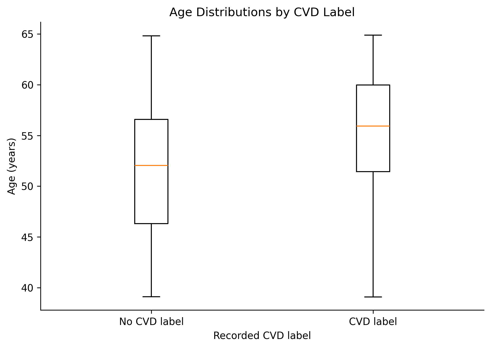
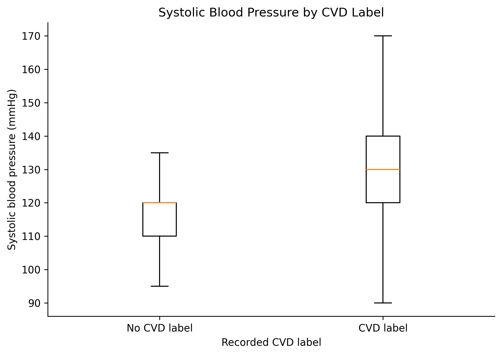
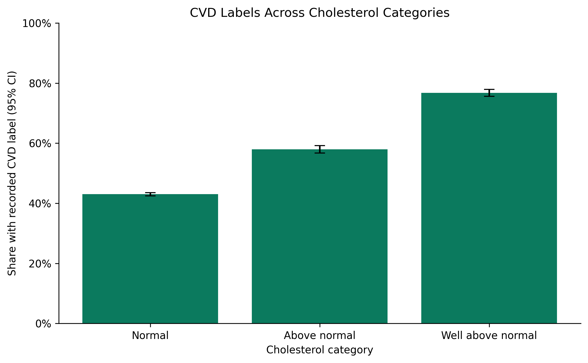

# Cholesterol's Role in CVD Labels

**Among women-coded records in one dataset, higher cholesterol categories were associated with higher odds of a cardiovascular disease label.**

By Sophia Hyder, Katsumi Nabwangu

A forest plot compares the estimated odds of a recorded CVD label across two cholesterol categories with the normal category. Both estimates are above the reference line of one, and the well-above-normal category has the larger estimate.

**Figure 1. Cholesterol categories and CVD labels.** Compared with normal cholesterol, above-normal and well-above-normal cholesterol were associated with higher adjusted odds of a recorded CVD label. The model accounts for age, systolic and diastolic blood pressure, and glucose. The bars show 95% confidence intervals. Source: our analysis of Dataset 1

## Introduction

Cardiovascular disease (CVD) is a major health concern, but a dataset cannot tell us what caused a person’s condition just by showing which measurements occurred alongside a CVD label. We focused on one question: among records coded as women, how were age, blood pressure, cholesterol, and glucose (risk factors) associated with the recorded CVD label?

In our analysis, cholesterol categories showed a clear pattern after accounting for the other measured factors. These results describe records in one dataset; they do not tell us what will happen to an individual or to women generally.

## The Data and Our Methods

We analyzed Dataset 1, the Cardiovascular Disease Dataset (cardiovascular_dataset_OpenBio_Final.csv), which contains individual-level records with measurements and a CVD label recorded at a medical exam. We used the 45,530 records coded as women in the dataset and, after applying our documented blood-pressure screening rules, analyzed 44,727 records. We converted age from days to years and treated cholesterol and glucose as categories. We fit a logistic regression model, which estimates how the odds of a yes/no outcome—in this case, a recorded CVD label—are associated with several factors while accounting for the others in the model. Our blood-pressure ranges were team-selected data-quality screening rules, not medical cutoffs. The dataset’s binary sex coding and its sample selection limit how broadly these findings can be applied.

## What We Found

### Higher cholesterol categories had higher adjusted odds of a CVD label

Compared with records in the normal cholesterol category, records in the above-normal category had **1.45 times the adjusted odds** of a CVD label (95% confidence interval: 1.36 to 1.55). Records in the well-above-normal category had **3.08 times the adjusted odds** (95% confidence interval: 2.83 to 3.35).

An odds ratio compares the odds in one category with the odds in a reference category. Here, normal cholesterol is the reference. A 95% confidence interval gives a range of estimates reasonably consistent with the model and data; it describes uncertainty in the estimate, not a range containing 95% of individual people.

These are odds comparisons, not risk comparisons. The outcome was common in this analysis, so it is especially important not to treat the odds ratios as risk ratios. The results also show association, not that cholesterol caused the CVD label.

### Age and blood pressure were also associated with the label

In the model that included both blood-pressure measures, each additional year of age was associated with higher odds of a CVD label (OR 1.057, 95% CI 1.054 to 1.061). Each additional millimeter of mercury (mmHg) in systolic pressure was associated with higher odds (OR 1.059, 95% CI 1.056 to 1.061), as was diastolic pressure (OR 1.012, 95% CI 1.009 to 1.016).

These odds ratios use different units: age is measured per year and blood pressure per mmHg. Their values should not be compared directly to decide which factor is “strongest.” Systolic and diastolic pressure were positively correlated in our data (r = 0.740), so their separate adjusted estimates may be difficult to distinguish.

**Figure 2. CVD-label share across age groups.** The plotted share of records labeled with CVD tended to rise across age groups. This is an unadjusted descriptive pattern; it does not account for the other variables in the regression. Source: our analysis of Dataset 1.

**Figure 3. CVD-label share across systolic blood-pressure groups.** The plotted share generally rose across systolic-pressure groups. The groups may contain different numbers of records, and this graph does not adjust for age, cholesterol, glucose, or diastolic pressure. Source: our analysis of Dataset 1.

### The glucose result was unexpected

Above-normal glucose was not clearly associated with the CVD label in the adjusted model (OR 1.034, 95% CI 0.947 to 1.128). The well-above-normal category had a lower estimated odds than the normal category (OR 0.745, 95% CI 0.677 to 0.819). This unexpected association does **not** mean high glucose protects against CVD. It may reflect features of how the records were collected or how the model adjusts for the other variables; our analysis cannot determine the explanation.

**Figure 4. CVD-label share by cholesterol category.** This graph shows the unadjusted share of records labeled with CVD in each cholesterol category. It is a descriptive comparison, not the adjusted regression result shown in Figure 1. Source: our analysis of Dataset 1.

### A check on the model

We evaluated discrimination on one random split, fitting the model on 80% of the records and testing it on the remaining 20%. The held-out area under the receiver operating characteristic curve (AUC) was **0.787**. AUC measures how well the model ranks records with and without the label in this split; 0.5 corresponds to chance ranking and 1.0 to perfect ranking. This is an internal check on these records, not proof the model will work in other populations or as a clinical tool.

As a sensitivity check, we refit the model without diastolic pressure. The AUC was 0.786, and estimates for the other predictors were broadly similar. This suggests the other estimates did not change much in this particular check; it does not show that diastolic pressure is unimportant.

## Unanswered Questions

This dataset does not tell us whether the measurements came before the development of CVD. It therefore cannot establish causes or estimate future disease risk. It also does not let us test whether these associations differ between women and men, or explain differences in CVD burden between countries. We did not include BMI, so this analysis does not assess whether body mass relative to height was associated with the CVD label.

The lower adjusted estimate for the highest glucose category is also unresolved. Further work would need to examine how the records were collected, whether other factors could explain the pattern, and whether it appears in an independent dataset.

## Conclusions, Limitations and Next Steps

In this dataset, higher cholesterol categories were associated with higher adjusted odds of a recorded CVD label among records coded as women. Age and blood-pressure measures were also associated with the label. These findings describe patterns in the analyzed records; they do not establish causes, predict an individual’s future health, or necessarily apply to women outside this dataset.

The data record sex as binary, and our results should not be generalized beyond the recorded categories and sample. The blood-pressure bounds were team-selected screening rules, not clinical thresholds. Our AUC came from one random split, with no external validation. With more time, we would test whether the results hold in an independent dataset and examine why the highest glucose category had a lower adjusted estimate.

This is a student data analysis. It is not medical advice, a diagnostic tool, or clinical guidance.

## Data and Code

- Repository: [link to your team repository]
- Data sources: [list each dataset with its link]

## Acknowledgements

Thank you to the organizers of Harvard's OpenBio, as well as all teammates and the advice from TerrierGPT.

---
