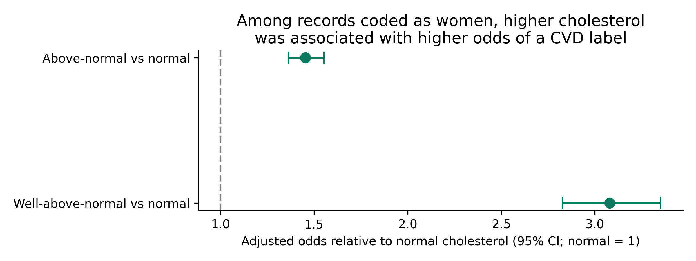

# Cholesterol's Role in CVD Labels

**Among women-coded records in one dataset, higher cholesterol categories were associated with higher odds of a cardiovascular disease label.**

By Sophia Hyder, Katsumi Nabwangu

A forest plot compares the estimated odds of a recorded CVD label across two cholesterol categories with the normal category. Both estimates are above the reference line of one, and the well-above-normal category has the larger estimate.

Figure 1. [Cholesterol categories and CVD labels.** Compared with normal cholesterol, above-normal and well-above-normal cholesterol were associated with higher adjusted odds of a recorded CVD label. The model accounts for age, systolic and diastolic blood pressure, and glucose. The bars show 95% confidence intervals. Source: our analysis of Dataset 1]

## Introduction

[The question you set out to answer and why it matters for women's cardiovascular health. Tell the reader what they are in for. No jargon.]

## The Data and Our Methods

[One short paragraph. Which data you used, where it came from and what you measured. Say upfront anything that limits your insights, such as synthetic data or country-level data. Link each dataset.]

## What We Found

[The bulk of the article. Present each result in numbers and in a graph, then explain what it means for a general reader. Explain every term. Point out anything unexpected. If you suggest a reason behind a result, say you are speculating.]

[Figure 2: add it here with `` and a caption underneath.]

[Figure 3]

[Figure 4]

## Unanswered Questions

[What the data could not answer, or where your results are inconclusive.]

## Conclusions, Limitations and Next Steps

[What the data showed and where that leaves your original question. Limitations: synthetic data, country-level versus individual, association versus cause. What you would do with more time.]

## Data and Code

- Repository: [link to your team repository]
- Data sources: [list each dataset with its link]

## Acknowledgements

Thank you to the organizers of Harvard's OpenBio, as well as 

---
